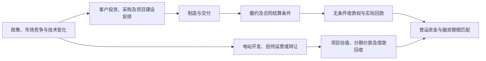

# 第三章完整写作支撑稿：低碳经济背景下MY企业概况与财务风险识别

版本：2026-10-16。用途：为作者撰写第三章提供证据、表图和分析段落，非论文定稿。结构对应新版开题报告第三章；文献综述不在本次范围。

## 使用前先确定的口径

主体分析采用2020—2025年度，2019年保留作基期。财务跨年表优先明确标为“各年当期披露”，不声称已将重述、合并范围和会计政策全部统一；近期两年重点事项优先使用2025年报同表比较。指标周转天数采用365天、期初期末净额均值，期初数来自同份年报，属于本章描述性口径；后续第四章若采用不同定义，应重新对照，不能直接套用。

2026半年报只作期后观察，注明未经审计，不填入2020—2025年度表、不参与第四章样本赋权，也不将期后预期变更写成2025年末已知事实。本文“风险信号”指需要关注的资金、期限及收益实现不确定性，不是已发生违约或量化风险等级。

新增08工作簿含来源目录、原文证据索引、政策时间线、行业统计、项目条款、财务指标和争议表；05、06工作簿仍是财务及经营环节的底层证据。本文P、I、T、R、A等编号均可在08来源目录查询；E编号为原文摘录。PDF页码为物理页，从1开始计数；会计师回复文件有封面目录，不能将印刷页码直接当PDF物理页。

## 3.1 低碳经济背景与风电行业经营环境

### 3.1.1 低碳经济发展与风电产业政策

低碳经济背景对MY企业的意义，一方面表现为清洁能源发展带来的装备制造、电站开发和运维需求，另一方面表现为项目收益形成方式、建设时点及资金回收条件的变化。MY企业同时经营风机制造、电站产品销售及自持发电业务，不能照搬高碳排放企业“碳成本增加—利润下降”的单一路径。

**表3-1 政策演进及适用边界**

|政策|成文日／官网发布日|执行或适用边界|本章如何使用|
|---|---|---|---|
|发改价格〔2019〕882号|2019-05-21／05-24|2019-07-01起执行；陆上按核准批次分别设置并网窗口，海上另列规则|解释不同项目建设、交付窗口，不能概括为所有陆上项目都在2020年底统一退补|
|财建〔2020〕4号|2020-01-20／02-03|新增海上风电不纳入中央补贴范围；满足核准及2021年底前全部并网等条件的存量项目衔接|区分中央补贴、地方支持及存量资格|
|发改价格〔2021〕833号|2021-06-07／06-11|2021-08-01起执行；2021起新核准陆上项目等实行平价，海上由省级价格主管部门制定等|平价阶段下设备成本和项目回报要求的背景|
|国发〔2021〕23号|2021-10-24／10-26|提出2025、2030阶段目标，推进风电、太阳能大规模和高质量发展|需求与发展机会，不能把政策目标当实际订单|
|发改价格〔2025〕136号|2025-01-27／02-09|按2025-06-01投产节点区分存量、增量，地方2025年底前实施方案；市场交易与机制电量差价结算并存|分别考察自持电站收益与设备客户决策；不能追溯解释2024年调价|

来源：P01—P05，E01—E10。发布日、成文日和执行日分列。2025年6月1日是项目投产分类节点，不是所有省份、所有项目统一执行新电价的日期。对具体项目评价仍应核对省份、投产日、机制电量、电价及执行期限；当前不编造项目适用参数。

可采用的分析：政策支持使风电产业获得持续发展空间，但收益实现仍取决于项目消纳、交易价格、结算机制与经营执行。外部机会与不确定性并存，不能把低碳经济本身定义为企业财务风险上升的原因。

### 3.1.2 风电行业市场竞争与技术变化

**表3-2 全国风电装机规模**

|年度|全国风电装机／并网规模，GW|原文精度及来源|
|---|---:|---|
|2019|210|正文2.1亿千瓦；I2019|
|2020|281|2.81亿千瓦；I2020|
|2021|328|3.28亿千瓦；I2021|
|2022|365|3.65亿千瓦；I2022|
|2023|441.34|全国电力统计表44134万千瓦；I2023|
|2024|521|5.21亿千瓦；I2024|
|2025|640|6.4亿千瓦；I2025|

图3-1建议使用“全国风电装机规模.png”。序列来自国家能源局统计原始发布，未掺入吊装、招标容量或GWEC媒体转述值。各年原文精度不同，图中不制造额外小数，也不由相邻年累计量差额代替新增量。2023年新增并网值本轮留空，累计规模已足够支持本节的产业扩展判断。

需求扩大不等于所有企业毛利同步提高。公司2024年监管回复披露，2023年平均千瓦收入由2022年的3121.46元降至2426.20元，降幅22.27%；平均千瓦成本由2566.75元降至2272.12元，降幅11.48%（R24第3页）。这支持描述公司当时售价调整快于成本下降，而不把公司平均千瓦收入称为全国风机招标均价。

技术方面，能源局转载央视网报道介绍了大容量、长叶片和深远海方向（J24，E11）；转载科技日报报道讨论从规模向价值竞争演变（J25，E12）。两者均标为新闻转载，不能因网站是政府域名就提升为政府统计结论；受访企业关于收益、技术效果的宣传数字不直接纳入本研究。该证据可说明行业竞争与技术变化的方向，不能证明MY企业的具体研发投入已经低效。

必须呈现阶段变化：2025年报披露风机及配件毛利率为6.38%，同比提高6.84个百分点（A25第24页）。故本节应写成“价格竞争与成本调整的阶段性压力”，不能写作2020—2025年持续单向下降。

### 3.1.3 行业经营条件与财务风险的传导关系

建议按两条业务链组织：

图中箭头表示经营联系和研究路径，不表示已估计因果效应。制造业务主要经客户决策间接受到电价变化影响，自持发电涉及直接交易结算，待售电站则涉及收益测算和买方估值。

目前已有比一般机制推演更具体的个案：2024年开鲁和奈曼旗项目调价说明明确将消纳、电价等市场与行业政策环境变化作为交易价格调整背景（TE第1页，E13）。这可以作为企业披露的“行业环境—项目估值—回收安排”关联事项，仍不能称为独立因果检验。全国风电平均利用率2024年原披露95.9%、2025年94%，可提示行业扩展与消纳约束并存，但全国平均值不能替代这两个项目的利用率或反推其损失。

## 3.2 企业概况

### 3.2.1 企业基本情况

MY企业对应明阳智慧能源集团股份公司。年报披露公司于2006年6月2日成立，2019年1月23日挂牌上市交易，总部位于广东中山，A股证券代码601615（A25第7、115页，E36—E37）。正文是否使用“MY”由作者按论文匿名约定统一。采用截至研究期末的公司状态，不将2026年发生的控制权事项混入2025年企业概况。

本段不必堆叠宣传性排名。年报中的行业领先、奖项等如使用，应注明是公司披露，并服务于业务特征说明。

### 3.2.2 主营业务与经营特征

公司核心业务包括风机及相关配件、电站产品销售、风电场发电等。2025年三项收入分别约310.10、45.06、13.54亿元（A25第24页），具有制造与项目开发运营并行的特点。

以出售为单一目的的电站项目列为存货，拟持有运营或没有明确出售目的的项目列为在建工程／固定资产（A25第124页）。因此，电站开发存货与购建长期资产现金支出并不等义；不能只用后一项估计全部电站建设资金需求。电站产品销售可通过项目公司股权转让实现，但会计列报仍须结合交易实质，不能因形式是股权转让就把全部收入和现金都视为处置投资活动。

风机业务也需分开观察交付、调试、运维等履约义务和合同收款节点。R24第20—21页说明，客户签收到货、后续预验收及质保各有节点，收入确认与付款安排并非同步。该回复中的典型周期和比例是当时的业务说明，不等于取得了2025年每份合同。

2025年末剩余履约义务对应收入约119.22亿元，属于已签约但尚未履行或未履行完毕的特定披露口径（A25第200页），不能称为全部市场订单，更不能视作已收现金。产销量表同时提示生产、库存包含内部订单而销量指外部订单（第24—25页），不据此机械计算滞销数量。

### 3.2.3 财务状况分析

使用附表“[财务状况与指标表](financial_tables.md)”中的2019—2025年原披露金额、六类描述性指标。正文建议展示收入与利润、现金流、资产负债和周转四组数据，而不堆砌全部51个财务科目。

2025年营业收入380.95亿元，同比增长40.27%；合并净利润6.98亿元，经营活动现金流量净额为－55.38亿元。与2024年相比，利润恢复而现金流仍承压，是需要进一步解释的现象。

重点比较必须保留改善：2025年应收账款周转天数由2024年约187.60天下降至146.66天，存货周转天数约169.91天下降至169.66天、基本持平。与此同时，资产负债率由约68.59%升至71.71%，流动比率由约1.28降至1.15，经营现金流收入比由约－8.85%降至－14.54%。这些指标揭示的方向不完全相同，应继续解释绝对占用、业务增长与现金收付结构，不宜概括为财务状况全面恶化。

上述比率为本项目按报表复算的描述值，周转分母包含全部营业收入／成本，并非逐份赊销合同；不能将周转天数称为逾期天数，也未设定高、中、低风险阈值。

## 3.3 基于财务指标的风险信号识别

### 3.3.1 筹资风险信号识别：经营占用与融资期限的匹配

2025年末短期借款38.20亿元，同比增长142.27%；非流动长期借款135.83亿元，低于上年139.42亿元。一年内到期非流动负债22.05亿元中，长期借款约11.64亿元、长期应付款5.80亿元、租赁负债0.54亿元、预计负债4.07亿元（A25第190页）。最后一项不能全部视为有息债务，长期应付款也需继续区分融资及非融资性质。

这些变化结合经营净现金流为负，可以提出经营占用与还款期限匹配的问题，但不能仅凭短期借款增幅认定资金链断裂。R24第52—53页对电站建设贷款、长期项目回收及资金分池管理作了解释，其中2024—2026需求测算是当时预算，不是实际资金缺口实现值。

财务费用由2024年3.42亿元增至2025年5.16亿元，而同表利息支出由5.28亿元降至4.85亿元。完整费用调节表已核对：利息资本化、利息收入、汇兑和其他项目共同影响费用，不应简单写成“短期借款增加导致全部财务费用上涨”。相关六项金额及符号见08工作簿“财务费用变动桥接”（A25第202页）。

授信方面，2025-026公告披露的是拟申请不超过1370.01亿元的额度，并明确最终以签订合同为准（C25第1、4页，E29）。该计划不能用作已获批或未使用授信，更不能代替可用现金。2025年现金受限构成已有附注证据；其余四个历史年度现金口径差额尚未解释，因此本章不使用未经核准的全期现金覆盖率下结论。

**可落笔的识别结论：**经营资金占用和短期借款增加并存，需要关注现金回收与融资期限匹配；当前公开证据不足以判断整体违约或确定的再融资缺口。

### 3.3.2 投资风险信号识别：项目价值调整与滚动开发回收条件

投资风险不能仅由投资现金流为负识别。2021—2023年购建长期资产现金支出较大，2025年下降至约25.38亿元；电站处置同时可能主动降低资产和担保敞口。

**表3-3 已有外部环境说明的电站交易价格调整**

|项目|2024年6月原公告价款|补充协议公告价款|下调金额|
|---|---:|---:|---:|
|开鲁明阳|9.599027亿元|8.162386亿元|1.436641亿元|
|奈曼旗明阳|5.575110亿元|4.867894亿元|0.707216亿元|
|合计|15.174137亿元|13.030280亿元|2.143857亿元|

来源：TK、TN、TP、TE。图3-2使用“电站项目转让价款调整.png”。公告将消纳、电价环境变化及风电利用率下降风险作为背景，同时说明担保解除、融资承接和盘活资产。价格下调事实不能直接等于2.14亿元已确认投资损失、资产减值或现金损失。TE还说明未实现内部交易损益在处置后转化为投资收益，不能直接拿项目单体净资产与集团处置收益作差就判断异常。

补充协议取消原第三、四、五期，其他金额、条件不变。但按旧价保留51%＋24%＋10%的机械测算，与公告新总价分别存在321305元和12905050元差额。本轮不强行配平，不把这些比例重新乘新总价。它不阻碍确认“价款调整”的事实，却限制精确重建每一期应付金额。

**表3-4 洮南百强：价款与往来回收分开**

|资金事项|公告安排|证据含义|
|---|---|---|
|股权转让价款9683.01万元|51%、44%、5%三期；分别对应备案资料移交、工商等手续、消缺条件|回收依赖具体条件，不是处置日一次性全部到账|
|第三期名义价款|按原价比例测算484.1505万元；公告另约定扣减146万元利息|比例测算不等于实际收到的尾款|
|应付北京洁源11100万元|工商变更完成之日起20个工作日内，由受让方支持项目公司一次性支付|与股权价款是不同资金关系，不能漏计或混称价款|
|融资与担保|公告称融资租赁后续由受让方承接、原担保已解除；本次交易仍需债权人同意|风险缓释与实施条件均需保留|

来源：TT第1、4—6页。A25第220页披露2025-03-27丧失控制权，支持处置事项已发生，但未给出上述每笔实际收款凭证。该项目在2024年12月收购前曾是工程客户，收购并表、内部抵销、转让出表影响科目可比性。不能把2023年工程款、2025年应付北京洁源款和后续股权价款直接当作同一笔余额连续滚动。

另有恒阳项目于2025年11月处置全部股权，年末其他应收款仍列其往来款约1.26亿元；这说明控制权转移后仍需跟踪资金关系，但缺少到期安排，不认定其已逾期。2025年汇总处置现金调节已核对，逐项目实际回款仍未取得，不将汇总现金随意分配给上述项目。

2025年报另披露苏格兰基地投资计划折算约142.10亿元，并说明截至年报披露日尚未投入资金（A25第32页，E33）。如写入本节，只能作为规划及审批不确定性，不能并入2025年实际资本支出或称为已实现损失。

**可落笔的识别结论：**电站滚动开发需关注环境变化下的估值调整、附条件分期回收及转让后资金关系；处置也有主动回笼资金和降低担保敞口的作用，现有材料不支持笼统认定全部电站投资失败。

### 3.3.3 营运风险信号识别：资金停留在何处

2025年末存货182.22亿元，其中发出商品57.33亿元、电站产品开发成本61.01亿元，合计占64.95%；两项增量约占全部存货增量67.93%（A25第158页，06工作簿）。应分别分析客户接受条件和电站开发转让进度，不能统一写成滞销。

2025年完整合同资产账面价值129.35亿元，包含流动31.55亿元及非流动97.80亿元，后者占约75.61%（A25第148页）。完整小计已经包含两部分，不再把三行相加。合同资产关注的是履约到形成无条件收款权之间的条件，不等于已到期未收的应收账款。

本轮补出了具体条件证据：R24第16页披露洮南百强合同资产18532.19万元涉及消防水池、水泵等消缺，尚未满足结算条件；截至2024年6月30日已转为应收账款。该改善只说明结算状态转变，不能称为已收回现金。另一EPC项目涉及叶片震动监测系统接入，依安明阳个案则涉及未到结算节点的质保金。由此可以说明结算占用有不同来源，不将所有合同资产归为质量保证金或客户违约。

信用期信号也须细分。R24第27页工程应收细表将洮南百强5589.81万元标为“是否在信用期内：否”，不能忽略这一不利披露；但同文件第15页含应收及合同资产的往来汇总表却标为“是”。两表差异已通过PDF图像复核，原样保留。正文可报告细表中的信用期外信号及披露口径分歧，不将全部24122万元往来或全部合同资产直接判为逾期。

2025年现金流调节表中的存货、经营性应收和应付三项净影响约－78.33亿元，完整调节表与经营净现金流吻合（A25第208页，05工作簿）。经营性应收不只包含应收账款，经营性应付不只包含供应商款；不能从这张表推断拖欠供应商或收入造假。

同时保留反证：2025年应收周转天数下降、存货周转天数基本持平；一年以上应收账款占比下降但绝对额增加。R23还披露2022年末应收在2023年1—5月已有18.24亿元期后回款，这只能说明对应时段回款事实，不外推为2025年的回收能力。

**可落笔的识别结论：**目前最充分的风险信号是较大的资金占用、结算条件及现金实现时点不一致。效率局部改善与现金流承压可以同时存在，后续需区分增长扩张带来的占用和合同执行中的具体问题。

### 3.3.4 发展风险信号识别：技术投入、费用阶段与收益实现

2025年研发总投入约11.10亿元，2024年约11.04亿元，增幅约0.60%；费用化研发增长36.81%，资本化占比由49.02%降至30.67%。因此，不应将费用增长直接写作研发总投入同步增长，也不应仅据费用支出判定研发低效。

A25第214页披露8—10MW及16—18MW风机项目处于开发阶段，预计完成时间分别为2026-07-31、2026-09-30。该材料支持关注开发周期及资本化后收益转化，但“预计完成日”不是承诺达产日，未按本研究取得的资料证实其技术失败。

产品质量保证预计负债2025年末约17.31亿元，上年约17.59亿元；关键审计事项提示估计的重要性，不能据此认定质量事故或计提不足。预计负债余额也不是当年实际质保现金支出。毛利率恢复是本节应保留的改善证据；电站产品与发电业务毛利率下降则应与制造端改善分开说明，不能由某一业务替代全公司趋势。

**可落笔的识别结论：**技术迭代下，研发阶段、资本化判断和未来收益转化存在需要跟踪的不确定性，现有证据适合提出发展风险信号，不足以判断全部研发投入无效。

## 3.4 本章小结

通过政策、行业统计、财务指标和具体经营事项的交叉核查，可以将MY企业的财务风险识别落实到四组问题：经营占用与融资期限匹配；电站项目价值调整及资金回收条件；制造交付、履约结算与现金实现的时差；研发投入阶段及未来收益转化。其中，营运资金占用和结算事项的证据最充分，项目调价与付款条款提供了投资回收方面的具名案例，筹资与发展维度则需保持结论强度与现有公开证据相称。

上述识别并非单向恶化判断。应收周转改善、制造毛利率恢复、资本支出下降以及项目担保解除等，构成对不利信号的重要补充。本章不根据背景叙述直接判断违约概率，也不预设第四章的权重和风险等级。第四章再按已识别问题选择指标，处理维度交叉、冗余、版本口径和评价参照。

## 期后观察附栏：仅在作者决定采用时另列

2026半年报未经审计（H26第2页）。截至2026-06-30，中广核风电股权转让款余额由2025年末20789万元降至16849万元，净减少3940万元；恒阳往来款和湖南国核股权款余额分别仍为约1.26亿元、0.67亿元（第104页）。余额未变不证明期间没有新增或回款，余额减少也不能在缺少明细时直接认定为现金收回。

同报告第154页披露以前期间处置于本期收到现金3940万元。该汇总收现与中广核余额净减少金额吻合，但未取得项目和收款归属的明确说明，故未标记为逐项目实际回款匹配成功。中广核作为两电站买方已核验，但还不能将对手总余额唯一拆给两项目。

第159页将8—10MW项目预计完成日列为2027-05-31，16—18MW项目列为2026-12-31，与2025年报的预期相比后移。该事实支持期后跟踪研发进度预期变化，不说明延期原因或失败，也不能倒填为2025年末已知事项。

## 写作边界与收口判定

现在已具备按原目录撰写第三章全部小节所需的公开证据基础，作者可以开展章节写作，无需等待每笔合同和回款凭证都取得后才动笔。但“章节可写”建立在上述限定表达上，不等于取得公司内部完整账簿或证实全部因果链。

仍然阻止更强结论的缺口包括：个别项目完整实际收现和到期安排；两项目精确分期金额桥接；洮南百强信用期标示差异；部分历史现金差额；项目地方电价参数及收益测算；实际质保支出和研发商业转化收益。没有这些证据，不写具体逾期天数、投资损失额、研发失败或偿债危机。

本轮检索和核验范围为用户年报及台账、指定年度公开公告列表、五项政策原文、七个年度能源局统计发布、两项行业报道、项目合同／进展公告、监管回复及2026半年报。公开镜像文件的来源性质与审计状态单列，未声称穷尽所有公开信息。第五章的系统语料编码、风险句强度统计并未完成，本轮定向摘录只服务第三章事实核实。

## 配套图表与原文

[财务表及五幅图](financial_tables.md)｜[官方和公告原文索引](source_register.md)｜[争议与写作边界](evidence_limits.md)
