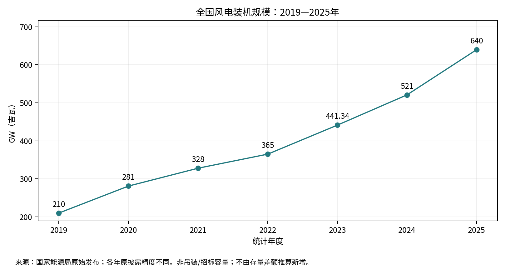
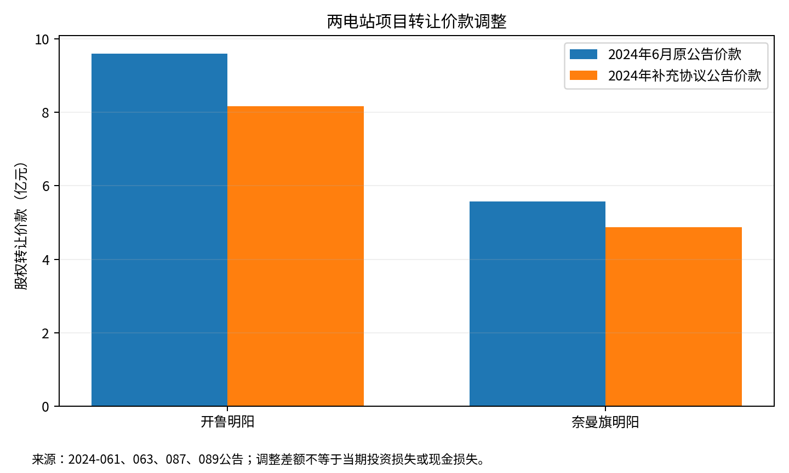
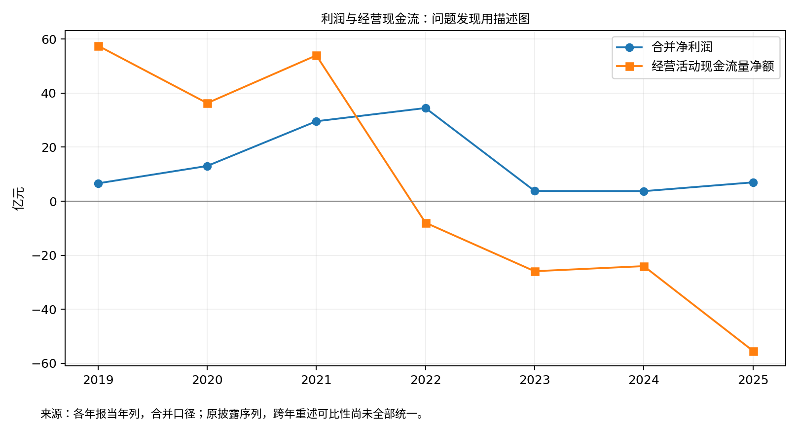
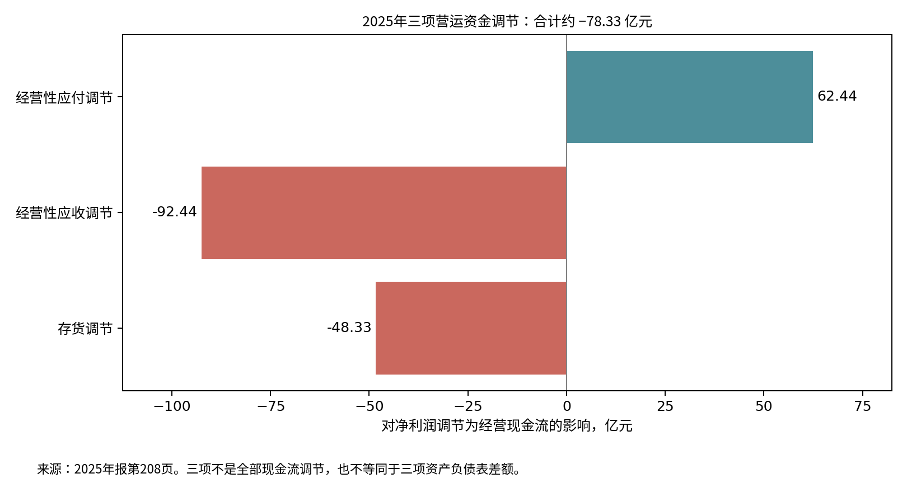
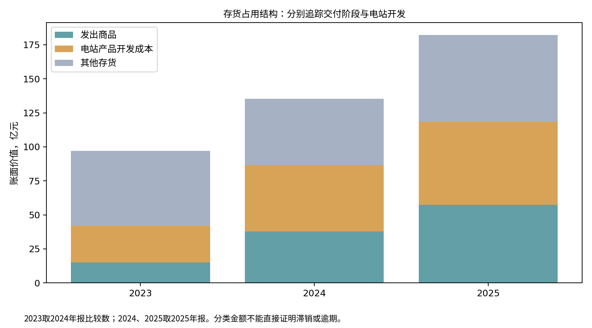

# 第三章财务状况与指标附表

金额为亿元；原始元值在工作簿与CSV中。各年当期披露尚未全期重述统一；2019仅作基期。长期借款是非流动部分，不等于全部银行借款。应收账款为净额，不含完整合同资产。

## 表A：原披露金额序列

| 年度 | 营业收入 | 合并净利润 | 经营净现金流 | 存货 | 应收账款净额 | 短期借款 | 长期借款（非流动） | 购建长期资产支出 |
|---|---|---|---|---|---|---|---|---|
| 2019 | 104.93 | 6.61 | 57.55 | 28.11 | 47.52 | 13.75 | 28.49 | 23.40 |
| 2020 | 224.57 | 13.04 | 36.31 | 84.72 | 37.14 | 1.49 | 35.98 | 33.06 |
| 2021 | 271.58 | 29.59 | 53.98 | 96.04 | 58.56 | 0.98 | 34.39 | 73.87 |
| 2022 | 307.48 | 34.49 | -7.96 | 80.24 | 107.74 | 2.60 | 52.57 | 80.09 |
| 2023 | 278.59 | 3.80 | -25.92 | 96.69 | 139.23 | 8.64 | 114.80 | 76.11 |
| 2024 | 271.58 | 3.72 | -24.03 | 135.38 | 137.77 | 15.77 | 139.42 | 56.47 |
| 2025 | 380.95 | 6.98 | -55.38 | 182.22 | 168.37 | 38.20 | 135.83 | 25.38 |

## 表B：描述性指标

| 年度 | 资产负债率 | 流动比率 | 销售净利率 | 经营现金流收入比 | 应收账款周转天数 | 存货周转天数 |
|---|---|---|---|---|---|---|
| 2019 | 79.56 | 1.24 | 6.30 | 54.85 | 178.11 | 95.71 |
| 2020 | 70.78 | 1.22 | 5.81 | 16.17 | 68.80 | 112.61 |
| 2021 | 69.92 | 1.13 | 10.90 | 19.87 | 64.31 | 154.60 |
| 2022 | 58.86 | 1.25 | 11.22 | -2.59 | 98.70 | 131.22 |
| 2023 | 66.07 | 1.15 | 1.36 | -9.30 | 161.78 | 130.52 |
| 2024 | 68.59 | 1.28 | 1.37 | -8.85 | 187.60 | 169.91 |
| 2025 | 71.71 | 1.15 | 1.83 | -14.54 | 146.66 | 169.66 |

资产负债率、销售净利率及经营现金流收入比单位为%；流动比率为倍；周转天数为天。周转按365天和同份年报期初期末净额均值计算，不代表合同逾期天数。

| 指标 | 公式 |
|---|---|
| 资产负债率 | 负债合计/资产总计×100 |
| 流动比率 | 流动资产/流动负债 |
| 销售净利率 | 合并净利润/营业收入×100 |
| 经营现金流收入比 | 经营净现金流/营业收入×100 |
| 应收账款周转天数 | 同份年报期初期末应收账款净额均值/营业收入×365 |
| 存货周转天数 | 同份年报期初期末存货净额均值/营业成本×365 |

## 表C：财务费用变动的会计项目桥接

金额为亿元。减项按sign列处理，不能将费用增加全部归因于借款利息增加。

| 项目 | 2024 | 2025 | 对费用增加的调节额 |
|---|---|---|---|
| 利息支出 | 5.2823 | 4.8519 | -0.4304 |
| 未确认融资费用转回 | 1.2224 | 1.1725 | -0.0498 |
| 减：利息资本化 | 1.4421 | 0.6957 | 0.7464 |
| 减：利息收入 | 2.0365 | 1.3708 | 0.6657 |
| 汇兑损益 | -0.2449 | 0.4587 | 0.7036 |
| 手续费及其他 | 0.6432 | 0.7387 | 0.0955 |

来源：2025年报第202页，同表比较；合计费用由3.4244亿元增至5.1553亿元。

## 图表

### 全国风电装机规模

### 项目转让价款调整

### 利润与经营现金流（各年原披露）

### 2025营运资金现金流调节

### 存货结构与业务阶段

